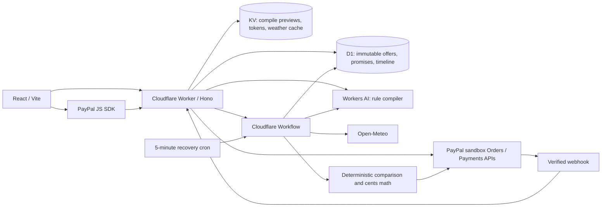

# Pinky Promise

**Promises that pay you back on their own.** A seller writes a weather guarantee in plain English. AI compiles a measurable rule. A buyer books through PayPal sandbox. A durable workflow checks the evidence and refunds the agreed amount when the condition is met.

**Live:** https://pinky-promise.aiconic-innovations.workers.dev  
**Seller workspace:** https://pinky-promise.aiconic-innovations.workers.dev/sell  
**Demo passcode:** `pinky-demo`

## Try it in two minutes

1. Open the seller workspace and use the demo passcode.
2. Create a promise using the prefilled $20 Golden Gate walking tour. Select a future window (all times are explicitly UTC).
3. Preview the AI rule, review its assumptions, and confirm publication.
4. Open the offer. Use **Try demo checkout** for a no-login simulation, or **PayPal** with a separate personal sandbox buyer account.
5. Return to Promise activity and simulate `12` mm of rain. Open the receipt: it updates automatically as the workflow checks the rule and returns $10.

Demo payments/refunds never move money and always carry a demo label. PayPal sandbox uses test money. Simulated evidence is independently labeled, even with a real sandbox transaction. Do not use live PayPal credentials. The sandbox host is fixed in server code.

## Architecture



Workers AI model: `@cf/meta/llama-3.3-70b-instruct-fp8-fast`, JSON Schema output with server-side Zod validation and one retry. AI never determines the numerical outcome or refund amount. It compiles the promise and explains the facts. The explainer has a factual fallback if AI is unavailable.

AI Gateway routing is implemented behind `AI_GATEWAY_ID`. Gateway provisioning was denied by the available Cloudflare OAuth permissions; this deployment currently calls Workers AI directly. Create a gateway and set that variable to enable its logging/cache layer.

## What is implemented

- Landing, protected seller workspace, public checkout, live receipt.
- Rainfall totals, maximum/minimum temperature, maximum/minimum wind; percent or fixed USD refunds.
- Five location presets; whole-hour UTC windows of 1–24 hours within the next 14 days.
- AI rejects subjective guarantees and requests clarification for missing conditions.
- Confirmed rule previews are stored server-side; clients cannot substitute an arbitrary rule at publication.
- PayPal JS SDK approval; server-side order creation and capture; capture recovery after a lost response.
- Verified capture/refund webhooks, deduplicated by PayPal event ID.
- Durable scheduled and simulated settlement through the same Workflow class.
- Real Open-Meteo hourly weather evidence with source URL and sample data on the receipt API. Missing/null/partial data causes review, never an assumed zero.
- Atomic settlement ownership, stable refund idempotency key, cent-based caps, and immutable paid rules.
- Weather retries; failure states preserve the timeline and direct the seller to review PayPal before retrying.
- Responsive layouts, form validation, modal focus trap, reduced-motion support, loading/error/empty states.

This is a shared single-merchant hackathon sandbox. The public demo passcode intentionally permits judges to manage test offers. Receipt UUID links are bearer links; keep them private. No buyer email is collected or exposed.

## Setup

Requires Node 22+, npm, and an authenticated Cloudflare account with Workers, D1, KV, Workers AI, and Workflows.

```sh
npm install
cp .env.example .env.local
# Populate .env.local with SANDBOX credentials only.
node scripts/configure.mjs --local
npm run db:local
npm run build
npm run dev:api
# In another terminal:
npm run dev
```

Workers AI needs a remote binding when developing locally; the live deployment is the verified reference environment. For a different account, create a D1 database and KV namespace and replace the account/binding IDs in `wrangler.jsonc` before deploying.

```sh
npm run db:remote
node scripts/configure.mjs
npm run deploy
```

`configure.mjs` reads ignored `.env.local` and sends only the app client ID, app secret, webhook ID, and dashboard passcode to Worker secrets via stdin. It never deploys the sandbox buyer password. It supports `CLIENT_ID`/`CLIENT_SECRET` or `PAYPAL_CLIENT_ID`/`PAYPAL_CLIENT_SECRET`.

## PayPal webhook

Listener: `https://pinky-promise.aiconic-innovations.workers.dev/api/paypal/webhook`

Subscribe to `PAYMENT.CAPTURE.COMPLETED` and `PAYMENT.CAPTURE.REFUNDED`. Save the ID as `PAYPAL_WEBHOOK_ID` in `.env.local` and run the configuration script. For the deployed app, `node scripts/configure.mjs --webhook` can register the webhook and install its secret; it reuses an existing listener with the same URL.

The personal sandbox buyer must be different from the merchant account associated with the REST app. PayPal refuses self-payments. Never commit test-account passwords.

## Validation

```sh
npm test                    # Numeric boundaries, cents, caps, weather coverage
npm run build               # TypeScript + production bundle
node scripts/smoke.mjs       # Live Chrome: compile → publish → demo checkout → refund
npx tsx scripts/weather-check.ts # Dedicated demo fixture: actual past weather → workflow
```

The smoke test verifies a $10 simulated refund on a $20 purchase, a 409 response for a duplicate settlement attempt, absence of browser exceptions, and no horizontal overflow at 390px. Screenshots and integration fixtures are written to ignored `test-results/`.

## Scope and limits

- Sandbox only; no production money, insurance underwriting, multi-seller onboarding, or subjective claims.
- Open-Meteo is model data, not a certified weather station reading; this assumption is shown before confirmation. Precipitation intervals use the preceding-hour convention `(start, end]`.
- KV IP compile throttling is best-effort, not a strict distributed quota. The public demo is not hardened for unrestricted production traffic.
- Email, vision claims, human review actions, Vectorize, and WebSocket push are not implemented. Receipts poll every 2.5 seconds.
- A failed/pending refund needs manual reconciliation; there is deliberately no blind retry button that could duplicate a refund outside PayPal's idempotency window.
- AI Gateway requires additional account permission; no gateway usage is claimed while unset.
- Video recording and Devpost submission are outside this build-and-deploy delivery.

## References

- [PayPal Orders v2](https://developer.paypal.com/api/orders/v2)
- [PayPal Payments v2](https://developer.paypal.com/api/payments/v2)
- [PayPal webhook verification](https://developer.paypal.com/api/webhooks/v1)
- [Workers AI JSON mode](https://developers.cloudflare.com/workers-ai/features/json-mode/)
- [Cloudflare Workflows](https://developers.cloudflare.com/workflows/build/sleeping-and-retrying/)
- [Open-Meteo data and attribution](https://open-meteo.com/en/docs)

MIT licensed. Weather data attribution: Open-Meteo, CC BY 4.0.
